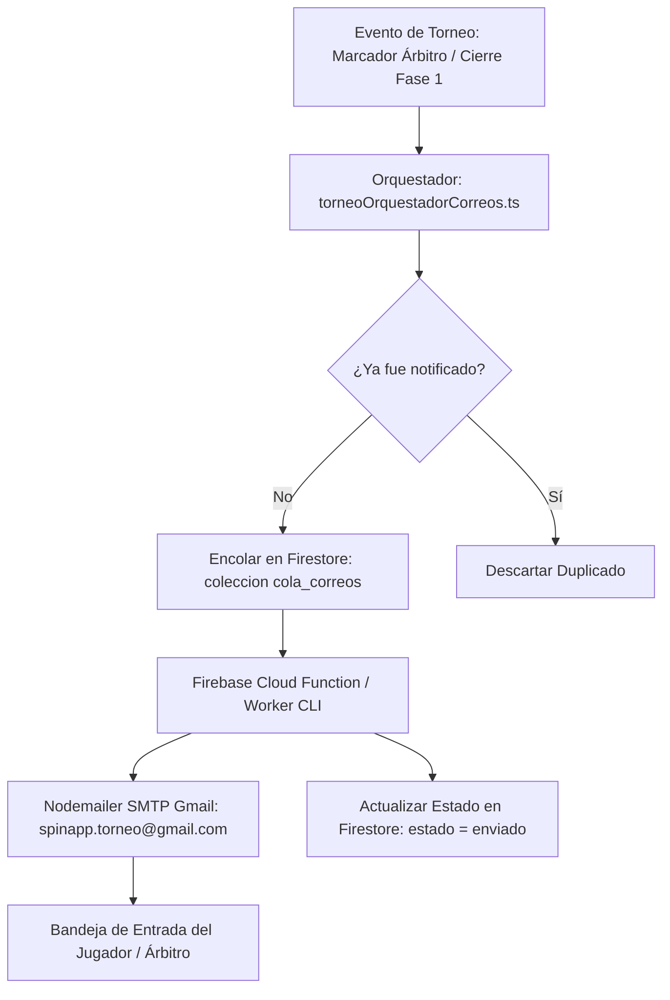

# 📧 Documentación Técnica: Sistema de Correos Transaccionales y Rediseño de Playoffs
**Proyecto:** spinApp 2026 — Plataforma Oficial de Tenis de Mesa  
**Rama:** `feature/sistema-correos-y-playoffs-responsive`  
**Fecha:** Octubre 2026  
**Responsable:** Felipe / Equipo de Desarrollo spinApp  

---

## 📌 1. Resumen Ejecutivo

En este ciclo de desarrollo se implementaron dos componentes estratégicos para la plataforma deportiva **spinApp 2026**:
1. **Sistema Transaccional de Correos y Notificaciones Oficiales:** Envío automatizado de correos corporativos en tiempo real para 8 fases del torneo, con plantillas responsivas en modo oscuro deportivo, integración con Gmail Workspace / SMTP seguro y panel de administración en vivo.
2. **Corrección de Lógica y Rediseño Responsivo de Playoffs (Fase 2):** Corrección estructural del cuadro de llaves (evitando duplicidad prematura de jugadores del repechaje en cuartos), navegación fluida para celulares/tablets con selector de rondas, alineación vertical del árbol de competencia y modo interactivo *"Mi Camino"*.

---

## 🛠️ 2. Configuración de Google Workspace / Gmail

Para garantizar alta entregabilidad, evitar la carpeta de Spam y cumplir con las normativas de seguridad de Google:

### Paso a Paso para la Cuenta Emisora
1. **Cuenta Oficial:** `spinapp.torneo@gmail.com`
2. **Seguridad en Dos Pasos (2FA):** Habilitada en [myaccount.google.com/security](https://myaccount.google.com/security).
3. **Contraseña de Aplicación (App Password):**
   - Se generó una contraseña dedicada de 16 caracteres exclusiva para el servicio de correos: `lfnz vrmr muql ixas`.
   - Permite conexión SMTP autenticada a través del puerto 465/587 sin requerir inicio de sesión web interactivo.
4. **Almacenamiento Seguro:** Las credenciales se configuran exclusivamente en variables de entorno de backend / Cloud Functions (`.env`), evitando cualquier fuga en el código de producción del cliente web.

```env
# Variables de Entorno del Despachador (.env)
GMAIL_USER=spinapp.torneo@gmail.com
GMAIL_APP_PASSWORD=lfnz vrmr muql ixas
```

---

## 🎨 3. Diseño y Estándares de las Plantillas de Correo

Las plantillas fueron diseñadas en HTML/CSS estructurado con tablas semánticas para garantizar compatibilidad del 100% en **Gmail (Web, iOS, Android)**, Apple Mail y Outlook:

* **Paleta Oficial Deportiva:**
  * **Fondo Principal:** Deep Stadium Navy (`#060b16` / `#0e172a`).
  * **Acento Primario CTA:** Naranja Pelota (`#f97316` / `#ea580c`).
  * **Secundario / Cancha:** Azul Tenis de Mesa (`#38bdf8`).
  * **Victoria / Éxito:** Verde Esmeralda (`#10b981`).
* **Botón de Gala (Pill Button):** Rediseñado con bordes curvados (`border-radius: 50px`), resplandor neón e icono direccional (`VER CUADRO DE PLAYOFFS ➔`).
* **Direccionamiento Oficial:** Todos los botones de acción enlazan directamente a la plataforma en producción:  
  👉 **`https://spinapptorneo.web.app/login`**
* **Cabecera de Marca Oficial:** Badge deportivo superior `🏓 CIRCUITO OFICIAL • CAMPUSLANDS` con tipografía de alto contraste sin cuadros oscuros residuales en modo noche.

---

## 📨 4. Catálogo de los 8 Correos Transaccionales

| # | Plantilla | Desencadenador Automático | Destinatario | Contenido Clave |
| :---: | :--- | :--- | :--- | :--- |
| **1** | **Recordatorio Partido Pendiente** | Partido con plazo < 48h sin disputar en Fase de Grupos | Ambos jugadores del cruce | Plazo límite, cancha asignada y **PIN de 5 dígitos** para validar con el árbitro. |
| **2** | **Cierre Fase 1: Top 4 (BYE Directo)** | Conclusión de todos los partidos del Round Robin | Jugadores puestos 1° al 4° | Felicitación, estadísticas (PJ, PG, Puntos) y pase directo a Cuartos sin jugar repechaje. |
| **3** | **Cierre Fase 1: Puestos 5° al 12°** | Conclusión del Round Robin | Jugadores clasificados a repechaje | Asignación a los **Octavos de Final (Play-In)** a partido único por el pase a Cuartos. |
| **4** | **Cierre Fase 1: Motivación a Eliminados** | Conclusión del Round Robin | Jugadores puestos 13+ | Agradecimiento por deportividad, tabla final y enlace a la transmisión en vivo de Playoffs. |
| **5** | **Cuartos de Final Confirmados** | Definición de los 4 ganadores del Play-In | 8 contendientes de Cuartos | Cartel VS del partido, mesa programada y advertencia de eliminación directa. |
| **6** | **Semifinalistas (Top 4 del Torneo)** | Finalización de la ronda de Cuartos | 4 semifinalistas | Ingreso al cuadro de honor, bolsa de premios en disputa y enlace al marcador en vivo. |
| **7** | **La Gran Final** | Finalización de ambas Semifinales | Todos los participantes del torneo | Cartel de gala con fotos/avatares de los 2 finalistas, horario, mesa y botón de streaming WebRTC. |
| **8** | **Coronación del Gran Campeón** | Registro del marcador final de la Final | Todos los participantes | Proclamación del Rey del torneo, subcampeón, marcador de sets y mención al *Mallero Mayor*. |

---

## 🏗️ 5. Arquitectura Técnica del Flujo de Correos



### Componentes Creados en el Código Fuente:
1. **[`src/services/emailTemplates.ts`](file:///c:/Users/corre/PingPongPage-1/src/services/emailTemplates.ts):** Generador tipado de plantillas HTML y texto plano para las 8 comunicaciones.
2. **[`src/services/emailService.ts`](file:///c:/Users/corre/PingPongPage-1/src/services/emailService.ts):** Funciones para encolar correos individuales o por lote (`despacharLoteCierreFase1`), consultar estados y escuchar en tiempo real.
3. **[`src/services/torneoOrquestadorCorreos.ts`](file:///c:/Users/corre/PingPongPage-1/src/services/torneoOrquestadorCorreos.ts):** Monitor de eventos reactivo que evalúa los marcadores y el estado del torneo para disparar los correos sin intervención manual del administrador.
4. **[`src/modules/admin/components/ModalCentroCorreos.vue`](file:///c:/Users/corre/PingPongPage-1/src/modules/admin/components/ModalCentroCorreos.vue):** Módulo de control visual para administradores con previsualización responsive (600px desktop / 375px mobile), disparadores de prueba y monitor de cola.
5. **[`functions/index.js`](file:///c:/Users/corre/PingPongPage-1/functions/index.js):** Cloud Function para despliegue serverless en Firebase (`onDocumentCreated`).
6. **[`scripts/despachar-cola.mjs`](file:///c:/Users/corre/PingPongPage-1/scripts/despachar-cola.mjs):** Worker CLI ejecutable localmente para pruebas con flags `--dry-run` o `--watch`.

---

## 🏆 6. Corrección de Lógica y Rediseño de Playoffs (Fase 2)

### 🐛 Problema de Lógica Corregido
* **Inconsistencia previa:** En la vista de Playoffs, un jugador ubicado en repechaje (ej. *Felipe Corredor #7* en Llave 3) aparecía al mismo tiempo programado en *Cuartos de Final (Cuartos 3)* contra el Top 2 antes de haber disputado su encuentro de repechaje.
* **Corrección aplicada en [`usePlayoffs.ts`](file:///c:/Users/corre/PingPongPage-1/src/modules/dashboard/composables/usePlayoffs.ts):**
  * Los cruces de Cuartos de Final se estructuran con el Top 4 esperando rival:
    * **Cuartos 1:** Top 1 (BYE) vs **Ganador Llave 1**
    * **Cuartos 2:** Top 4 (BYE) vs **Ganador Llave 2**
    * **Cuartos 3:** Top 2 (BYE) vs **Ganador Llave 3**
    * **Cuartos 4:** Top 3 (BYE) vs **Ganador Llave 4**
  * Si el partido de repechaje está por jugar, se presenta el identificador de la llave correspondiente. Una vez finalizado el partido con marcador oficial, el ganador real avanza automáticamente al cruce de Cuartos.

### 📱 Mejoras de Experiencia de Usuario y Responsividad ([`EliminatoriasConcentric.vue`](file:///c:/Users/corre/PingPongPage-1/src/modules/dashboard/views/partials/participacion/EliminatoriasConcentric.vue))
* **Selector por Pestañas para Móviles (< 1024px):** Pestañas dedicadas (`Play-In`, `Cuartos`, `Semis`, `Final 👑` y `Todas`) que despliegan los partidos en columnas completas adaptadas al ancho de pantalla del celular sin forzar un scroll horizontal incómodo de 900px.
* **Alineación Vertical del Árbol:** En pantallas de escritorio, las Semifinales quedan simétricamente centradas entre los cruces de Cuartos, y la Gran Final se posiciona como el núcleo estelar del campeonato.
* **Modo "Mi Camino" Potenciado:**
  * Al activar el botón de brújula (*Mi Camino*), se despliega un banner de estado con la ruta del jugador:  
    *“🎯 Ruta Personal Hacia la Corona: Disputas Play-In (Llave 3) vs Juan Cogollo. El ganador avanza a Cuartos 3”*.
  * Ilumina la tarjeta activa del usuario con un distintivo `TÚ` en verde esmeralda y resalta su proyección hasta la Gran Final.
* **Tarjeta de Gala de la Gran Final:** Marco dorado degradado, bolsa de premios oficial (`$180.000 COP • 100% Ganador`), indicador central VS y apertura de modal detallado con marcador set a set.

---

## 🚀 7. Guía de Ejecución y Pruebas

### 1. Iniciar la Aplicación en Modo Desarrollo
```bash
npm run dev
```

### 2. Ejecutar el Despachador de Correos en Segundo Plano
```bash
npm run email:worker
```

### 3. Ejecutar una Prueba de Envío Directo por Correo
```bash
node scripts/test-enviar-felipe.mjs
```

### 4. Validar Tipado y Compilación para Producción
```bash
npm run type-check   # Verificación con vue-tsc (0 errores)
npm run build-only   # Compilación Vite optimizada (1.35s)
```

---

## 📦 8. Información de la Rama en Git
* **Rama de Trabajo:** `feature/sistema-correos-y-playoffs-responsive`
* **Commit Principal:** `f63b753 feat: implementar sistema de correos transaccionales y rediseño responsivo de playoffs`
* **Merge con Main:** `09d7ce0 Merge origin/main into feature/sistema-correos-y-playoffs-responsive`
* **Estado en GitHub:** Rama publicada y sincronizada con el repositorio remoto `origin`.
